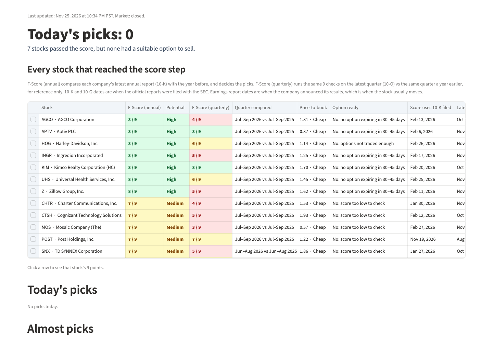
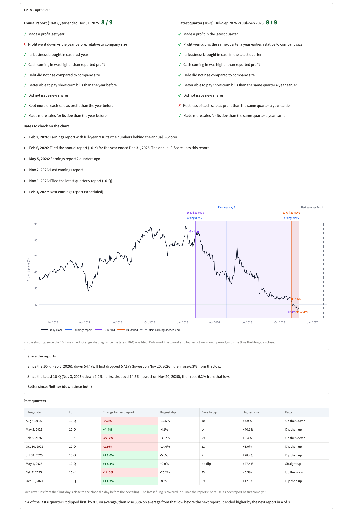

# 📈 F-Score Stock Screener

**A fundamental stock screener for US mid- and large-cap companies.** It looks for stocks that are cheap compared with their sector (low price-to-book) but financially healthy, as measured by the 9-point **Piotroski F-Score**. For stocks that pass, it suggests a covered-call setup and explains it in plain language.

**Live app:** none yet. This is a Streamlit dashboard you run locally (see [Quick start](#quick-start)).



---

## The problem

Cheap stocks are often cheap for a reason. Buying on a low price-to-book ratio alone tends to find "value traps," companies that are cheap because their business is getting worse. Joseph Piotroski's research (*"Value Investing: The Use of Historical Financial Statement Information to Separate Winners from Losers,"* 2000) proposed a simple fix: among low price-to-book stocks, keep only the companies whose financial statements show improving profitability, balance-sheet strength and efficiency.

Checking nine accounting tests across hundreds of companies by hand is slow, and most retail investors don't want to read 10-K filings. This tool automates the screen, ties every score to the SEC filing it came from, and explains each result in everyday language.

## What it does

1. **Screens a universe** of about 330 US-listed mid- and large-cap stocks, excluding financials and utilities. It works through a 7-step funnel:
   1. US exchange
   2. market cap between $2B and $50B
   3. sector filter
   4. liquidity: average volume of at least 500k shares and a price of at least $10
   5. the cheapest 20% by price-to-book within each sector
   6. an annual F-Score of 8 or 9
   7. a tradable option exists
2. **Scores each company** on the 9 Piotroski tests, annually (latest 10-K vs. the year before). A **quarterly F-Score** (latest 10-Q vs. the same quarter a year earlier) is also shown, for reference only.
3. **Suggests a covered call** for each pick. It finds the call option 30–45 days out with a delta closest to 0.30 that clears minimum volume and open-interest thresholds, then states the trade in plain terms: *buy 100 shares, sell 1 call, you collect $X*. It also shows the maximum profit, break-even and estimated monthly premium yield.
4. **Explains every stock:**
   - side-by-side annual and quarterly checklists with ✓ / ✗ for each test
   - a list of key dates: SEC filing dates and earnings report dates
   - a 2-year price chart marking earnings and 10-K/10-Q filing dates
   - a "Past quarters" table showing how the price moved after each of the last 8 filings (biggest dip, highest rise, pattern)
5. **Shows near misses.** "Almost picks" lists stocks that scored 8+ but had no suitable option, with the reason.
6. **Tracks paper trades.** Log a pick to a local paper portfolio, follow its profit or loss using live option quotes, and simulate closing a trade at expiration or on assignment.
7. **Offers more detail in expanders:**
   - funnel counts
   - full scorecards with the underlying line items
   - a payoff chart and order details
   - links to the SEC filings
   - an earnings-risk calendar (HIGH within 7 days, MEDIUM within 14, otherwise CLEAR)
   - a CSV export



## The 9-point Piotroski F-Score

Each test scores 1 point if it passes. The app compares the current period (*t*) with the prior one (*t−1*).

**Profitability (4 points)**
1. Net income > 0
2. Return on assets (net income ÷ total assets) improved
3. Operating cash flow > 0
4. Operating cash flow > net income, meaning earnings are backed by cash

**Leverage, liquidity and funding (3 points)**

5. Long-term debt ÷ total assets did not increase
6. Current ratio (current assets ÷ current liabilities) improved
7. No new shares issued

**Operating efficiency (2 points)**

8. Gross margin improved
9. Asset turnover (revenue ÷ total assets) improved

Missing data scores 0 for that test and is flagged in the scorecard.

## How it works

```
Yahoo Finance (via yfinance) ──▶ profiles, annual + quarterly statements, prices, option chains ─┐
SEC EDGAR REST API ───────────▶ 10-K / 10-Q filing dates and document links ────────────────────┤
                                                                                                ▼
            universe.py (7-step funnel) ─▶ piotroski.py (scores) ─▶ options_engine.py (call selection)
                                                                                                │
            price_reaction.py · earnings_tracker.py · paper_trader.py ─▶ app.py (Streamlit) ◀───┘
```

- **Market data** (company profiles, financial statements, price history, option chains) comes from Yahoo Finance through `yfinance`.
- **SEC EDGAR** supplies filing dates and links to the official 10-K and 10-Q documents. Requests send a declared `User-Agent` and are throttled to stay under SEC's fair-access limit.
- **Option delta** is calculated with the Black-Scholes model from Yahoo's implied volatility.
- **Disk cache** with separate lifetimes per data type: options 15 minutes, prices 1 hour, profiles and SEC data 24 hours, financial statements 7 days. This avoids repeated API calls.

## Project structure

```
├── app.py                     # Streamlit dashboard
├── requirements.txt
├── .streamlit/config.toml     # Dashboard theme
├── src/
│   ├── config.py              # Filters, cache lifetimes, SEC user-agent, universe preset
│   ├── data_provider.py       # yfinance data access + disk cache
│   ├── sec_edgar.py           # SEC EDGAR client (filing dates, document links)
│   ├── universe.py            # 7-step screening funnel
│   ├── piotroski.py           # Annual + quarterly 9-point F-Score with audit details
│   ├── options_engine.py      # Black-Scholes delta, call selection, payoff, order details
│   ├── price_reaction.py      # Price moves after each filing
│   ├── earnings_tracker.py    # Earnings dates and event-risk bands
│   └── paper_trader.py        # Local paper-trading portfolio
└── tests/
    ├── test_screener.py       # Scoring, delta, option selection, payoff, earnings
    ├── test_price_reaction.py # Post-filing price-move logic
    └── test_run_e2e.py        # End-to-end pipeline on an offline fake data provider
```

## Tech stack

| Area | Technology |
|---|---|
| Language | Python 3.10+ |
| Dashboard | Streamlit |
| Data | pandas, NumPy |
| Charts | Plotly |
| Market data | Yahoo Finance via `yfinance` |
| Filings | SEC EDGAR REST API (`requests`) |
| Testing | `unittest` (32 tests, including an offline end-to-end run) |

## Quick start

```bash
git clone https://github.com/azizalharbi17/F-Score-Stock-Screener.git
cd F-Score-Stock-Screener
python3 -m venv .venv
source .venv/bin/activate          # Windows: .venv\Scripts\activate
pip install -r requirements.txt

python -m unittest discover tests  # run the test suite
streamlit run app.py               # open http://localhost:8501
```

Optional: SEC asks automated clients to include contact details in their `User-Agent`. To do that, create a `.env` file (it's git-ignored) containing `SEC_USER_AGENT="YourAppName your-email@example.com"`.

The first run downloads data for the whole universe and can take a few minutes. Later runs use the disk cache. Outside market hours, option bids are often zero, so there may be no picks until the market opens.

## How I built this

I built this screener using **AI-assisted development with Claude Code**. My role was:

- leading the product concept and choosing the strategy
- defining the screening rules and the plain-language presentation
- testing and debugging the results
- iterating on the dashboard, including a redesign into the plain-language layout and adding the quarterly score, filing dates and post-filing price analysis

Claude Code generated most of the code under my direction.

## Disclaimer

This is a research and education tool. The yield, probability and payoff figures are estimates computed from current market quotes, not predictions or guaranteed results. Options carry risk. **Nothing here is financial advice.**
